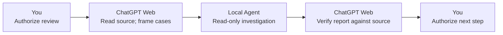

# GPT-Agent Bridge

**Give your coding agents a Principal.**

Coding agents can execute tasks. Who keeps the bigger picture in view?

Building software takes more than writing code. Someone must frame and reframe
the problem, challenge assumptions, weigh alternatives, coordinate investigations,
and evaluate what the evidence actually supports. Decisions also need their
reasons preserved across chats. Without that continuity and judgment, you become
the manual dispatcher and reviewer, piecing together each Agent's work yourself.

Web Principal changes this relationship. Use **ChatGPT Web in a Project**, with
the Principal Core in its instructions, as your always-on high-level cognitive
partner. It helps keep the larger engineering question in view, develops
acceptance cases, and takes responsibility for the final synthesis. Project-local
state and memory preserve decisions and their causes for the next chat.

The Principal and Agents form **one collaborative AI team**. Bridge connects
your existing compatible **Herdr-managed Agent CLIs** across models and providers,
without a model/provider whitelist. Within Herdr's session and project-placement
requirements, Agents investigate and implement locally; the Principal seeks
divergent perspectives, independent challenge and cross-validation, then checks
reports against source evidence. **You retain goals, scope, material decisions
and authorization.**

## What Bridge adds

- **A partner for the bigger picture.** The Principal compares alternatives,
  questions assumptions and synthesizes a judgment, rather than just tracking
  task completion.
- **A team with different model perspectives.** Reuse any compatible
  Herdr-managed Agent CLI that meets session and project-placement requirements;
  Bridge has no model/provider whitelist. Cross-check findings and compare
  competing proposed fixes.
- **Delegate, then keep thinking and researching.** Dispatch bounded Agent
  investigations while the Principal does useful independent work. Where
  available, ChatGPT Web Search and Deep Research add host research alongside
  local Agents; they are separate from Bridge delegation. An explicitly enabled local extension can
  send short completion reminders to the selected ordinary Chat, with no guarantee of delivery or model wake.
- **Verify beyond reports.** Agents publish complete reports; ChatGPT can read,
  search and diff the selected project to check conclusions against source and
  acceptance cases. A readable report is evidence, not proof of success.
- **Review images and original files.** Observe native images and prepare
  original PDF/DOCX/ZIP ResourceLinks. Preparation is not upload, automatic
  parsing or host import; multipart recipients assemble and verify the original.
- **Carry decisions forward and act precisely.** Project-local state/memory and
  four reusable Skills support resumption. Separately authorized exact edits and
  Git candidate/commit actions keep local changes reviewable.
- **Use the ChatGPT Web plan you already have.** No separate API-billed Principal
  reasoning controller. Your subscription's reasoning and usage quotas still
  apply; Agent-provider usage and relay costs remain separate.

**One Principal. Many models. One collaborative team.**

## Install and begin

Use the complete release directory and its **`prepare`** entry (Windows: **`Start-Bridge.ps1`**).
Follow [Getting started](docs/GETTING-STARTED.md) for trust, account/permission steps
and recovery. The entry checks/downloads dependencies, prepares the existing strict
Bridge/Tunnel services and one browser extension, then ends at software readiness. Codex is not an installation prerequisite. Herdr and Agent CLIs are
user-managed: open Herdr, cd to your repository and start your Agent yourself.
Bridge/Tunnel stay in the background; daily use needs no preparation entry.
Ordinary Web Chat may be opened before or after the Agent.

The installer ends at software readiness. Connect repositories in ordinary Web
through the existing project-onboarding Skill; the extension discovers those
registered identities without a second local list or restart.
One installation can authorize multiple local projects and explicitly bind each to
one ordinary ChatGPT Chat. Adding a project does not reinstall the extension or
restart Bridge. New reminders include the source project and full Work identifiers.
This is a source-tested candidate, not a claim of fresh-account or Windows acceptance.

## How it fits together

Descriptive architecture — these roles are not executable commands:

```text
You: goals, scope, key tradeoffs and authorization
  |
ChatGPT Web Chat/Project: Principal reasoning and instructions
  |
Your Secure MCP Tunnel or HTTPS/App connection
  |
Bridge: explicit project selection, delegation, evidence and continuity tools
  |
Herdr: existing compatible local coding Agents in their native CLIs
  |
Your selected Git checkout(s)
```

Bridge is the tool infrastructure in this system, not another reasoning engine.
Project Instructions provide the always-on Core; Plugin Skills provide triggered
procedures; tool schemas define operations; local rules/state/memory preserve
project-specific judgment. No instruction template is an OS sandbox.

The [portable Principal Core](templates/WEB-PRINCIPAL-CORE.md) is ready to copy
into your own Project Instructions. [Web Principal](docs/WEB-PRINCIPAL.md)
explains its responsibilities and version. This public generic adaptation needs
your review and manual installation; Bridge does not configure your Project.

<a name="an-illustrated-review-workflow"></a>

## Example: Catch a two-cent invoice bug

An invoice adds **$0.29 + $1.15**. The correct total is **$1.44**, but our
[shipped fixture](examples/first-use/README.md) converts each amount with `float`
and truncates cents, yielding **$1.42**. It also silently treats missing values
as zero. A plausible-looking total can hide lost cents and incomplete data.

Ask ChatGPT Web, acting as Principal, to read the actual source and form
acceptance cases: preserve both cents, reject missing values, and handle large
amounts exactly. Then authorize one bounded, read-only review by an
already-running Herdr Agent. ChatGPT compares the report with the source and
test expectations; you separately authorize any repair.



This narrated workflow is **illustrative, not an executed fix**. You may run
the tests yourself; Bridge has no generic test execution tool. Follow the
[first-use guide](docs/FIRST-USE-WALKTHROUGH.md) to try the review.

## Reference paths after setup

New users should follow [Getting started](docs/GETTING-STARTED.md), the single
installation and first-collaboration route above. Do not repeat installation from
the reference guides after completing it.

- [ChatGPT Project setup](docs/CHATGPT-PROJECT-SETUP.md) is the detailed manual
  Core/connection/Skills reference, not a second required setup sequence.
- [Developer Quickstart](docs/QUICKSTART.md) and [Windows + WSL2](docs/WINDOWS-WSL.md)
  are alternative manual/foreground routes for developers and troubleshooting.
  [Autostart](docs/AUTOSTART.md) documents the service contracts used by preparation.
- If tools work but native Skills are missing, see
  [Install the four Skills](docs/INSTALL-BRIDGE-SKILLS.md); reuse your Bridge connection.
- The [first-use walkthrough](docs/FIRST-USE-WALKTHROUGH.md) is an optional exercise,
  not an installation or continuity-initialization prerequisite.

The maintainer reports field use with **Plus/Pro** and Windows WSL. These are
reported use cases, not automatic eligibility for every account or a fresh-host
acceptance guarantee. New clean WSL2 onboarding has not been field-validated;
the Linux codepath is not a claim of separately accepted bare-metal Linux.
Windows-native and macOS-native operation are unsupported/unverified.

## Tool reference

The [technical reference](docs/TECHNICAL-REFERENCE.md#tool-reference) contains the
**18-tool SOURCE catalog**; the retired app-only continuation
tools are absent. It also preserves migration notes, exact bounds and historical caveats.
Use actual client schemas; catalog annotations describe behavior, not authority.
See [original-file attachments](docs/TECHNICAL-REFERENCE.md#original-file-attachments)
for ResourceLinks, multipart assembly, fetch validation and transport limits.

## Linked checkouts and user-preplaced Agents

[Linked checkouts](docs/TECHNICAL-REFERENCE.md#linked-checkouts-and-user-preplaced-agents)
are optional write domains, not isolation. You select and launch Agents before
Bridge delegation; Bridge does not create worktrees, launch Agents or move them.

## Document owners and audiences

| Read next | Purpose |
| --- | --- |
| [Getting started](docs/GETTING-STARTED.md) | New-user installation and first collaboration |
| [Project setup](docs/CHATGPT-PROJECT-SETUP.md) / [Web Principal](docs/WEB-PRINCIPAL.md) | Detailed manual Core, connection and Skills reference |
| [Quickstart](docs/QUICKSTART.md) / [Windows + WSL2](docs/WINDOWS-WSL.md) / [Secure MCP Tunnel](docs/OPENAI-SECURE-MCP-TUNNEL.md) | Foreground setup, private transport and own-App boundaries |
| [Bridge + Tunnel autostart](docs/AUTOSTART.md) | Optional boot/login setup, explicit activation and migration limits |
| [First use](docs/FIRST-USE-WALKTHROUGH.md) / [Invoice example](examples/first-use/README.md) | One bounded review, evidence checks and optional fresh-chat handoff |
| [Technical reference](docs/TECHNICAL-REFERENCE.md) | Full catalog, migrations, bounds, verification commands and optional service adoption |
| [Plugin Skills](docs/PLUGIN-SKILLS.md) / [Project continuity](docs/PROJECT-CONTINUITY.md) | Four procedures, routed state/memory and conditional publication |
| [Lifecycle](docs/LIFECYCLE-RESTART-CONTRACT.md) / [Work capacity](docs/WORK-CAPACITY.md) | Dispatch, continuation, restart, retention and pressure |
| [Observation tools](docs/OBSERVATION-TOOLS.md) / [Work evidence](docs/WORK-EVIDENCE.md) | Read/search/diff, exact edits, Git candidates and provenance |
| [Native execution retirement](docs/NATIVE-EXECUTION.md) / [AGENTS](AGENTS.md) | Removed execution surface and contributor boundaries |

Specialist documents remain the owners of their detailed contracts. This public
source ships no actual project cognition, private acceptance artifacts, working
App binding or configured service. Shared cognitive memory across hosts is not
implemented.

## Verification and deployment boundaries

Find exact default/stress commands and fixture limits in the
[verification reference](docs/TECHNICAL-REFERENCE.md#verification-and-deployment-boundaries).
Source/tests do not certify a running service, client-bound schemas or live host
behavior. Report reads do not prove review; notification consumption is not result
processing. Unknown delivery or mutation does not justify blind retry.

[Optional system service adoption](docs/TECHNICAL-REFERENCE.md#optional-system-service-adoption)
requires an already running Bridge. The installer does not start or enable it.
Successful tests never authorize a commit, push, restart, deployment or Agent input.

## License

Released under the [MIT License](LICENSE). Copyright (c) 2026 tomoyo.
