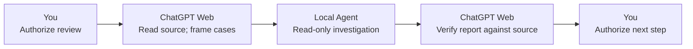

# GPT-Agent Bridge

**Make the most of your existing ChatGPT Web plan.**

Use actual **ChatGPT Web Chat/Projects as your Principal** to guide compatible
existing **Herdr-managed local coding Agents** through Bridge, with no separate
API-billed reasoning controller. Keep the native agent CLIs you already use.

“Principal” means your high-level cognitive partner: frame the problem, challenge
assumptions, compare options, delegate investigations and make the final synthesis.
Agents execute; ChatGPT reviews the evidence; you retain goals, scope and authority.

## What Bridge adds

- **Reason with the ChatGPT Web plan you already have.** Its reasoning and usage
  limits still apply. Agent-provider usage and relay costs are separate; Bridge
  does not make them free or provide additional ChatGPT quota.
- **Use existing heterogeneous Agents and native CLIs.** Herdr supplies the local
  substrate. Compatibility and an eligible running Agent are prerequisites;
  Bridge does not launch Agents or support every coding agent automatically.
- **Delegate, then keep thinking.** Dispatch a bounded batch and continue useful
  independent work. A compatible host can attempt one follow-up after the batch
  classifies; this is not a guarantee of delivery or model wake.
- **Review evidence directly.** Agents publish complete reports; ChatGPT can
  independently read, search and diff the selected project before accepting a
  conclusion. A readable report is evidence, not proof of task success.
- **Bring original files into the review.** Observe native images and prepare
  original PDF/DOCX/ZIP ResourceLinks. Preparation is not upload, automatic parsing
  or host import; multipart recipients assemble and verify the original.
- **Carry decisions forward and act precisely.** Project-local state/memory and
  four reusable Skills support resumption. Separately authorized exact edits and
  Git candidate/commit actions keep local changes reviewable.

## How it fits together

Descriptive architecture — these roles are not executable commands:

```text
You: goals, scope, key tradeoffs and authorization
  |
ChatGPT Web Chat/Project: Principal reasoning and instructions
  |
Your Secure MCP Tunnel or HTTPS/App connection
  |
Bridge: explicit project selection, delegation, evidence and continuity tools
  |
Herdr: existing compatible local coding Agents in their native CLIs
  |
Your selected Git checkout(s)
```

Bridge is the tool infrastructure in this system, not another reasoning engine.
Project Instructions provide the always-on Core; Plugin Skills provide triggered
procedures; tool schemas define operations; local rules/state/memory preserve
project-specific judgment. No instruction template is an OS sandbox.

The [portable Principal Core](templates/WEB-PRINCIPAL-CORE.md) is ready to copy
into your own Project Instructions. [Web Principal](docs/WEB-PRINCIPAL.md)
explains its responsibilities and version. This public generic adaptation needs
your review and manual installation; Bridge does not configure your Project.

<a name="an-illustrated-review-workflow"></a>

## Example: Catch a two-cent invoice bug

An invoice adds **$0.29 + $1.15**. The correct total is **$1.44**, but our
[shipped fixture](examples/first-use/README.md) converts each amount with `float`
and truncates cents, yielding **$1.42**. It also silently treats missing values
as zero. A plausible-looking total can hide lost cents and incomplete data.

Ask ChatGPT Web, acting as Principal, to read the actual source and form
acceptance cases: preserve both cents, reject missing values, and handle large
amounts exactly. Then authorize one bounded, read-only review by an
already-running Herdr Agent. ChatGPT compares the report with the source and
test expectations; you separately authorize any repair.



This narrated workflow is **illustrative, not an executed fix**. You may run
the tests yourself; Bridge has no generic test execution tool. Follow the
[first-use guide](docs/FIRST-USE-WALKTHROUGH.md) to try the review.

## Getting Started

**18 Tools, 0 Skills?** [Install the four Skills](docs/INSTALL-BRIDGE-SKILLS.md)
using your existing Bridge connection.

Start with [ChatGPT Project setup](docs/CHATGPT-PROJECT-SETUP.md) to assemble the
Core, connection, Skills and explicit project binding. For the local stack, use
the [developer Quickstart](docs/QUICKSTART.md); on Windows, start with
[Windows + WSL2](docs/WINDOWS-WSL.md).

You will need:

- Git and Python **3.10+** with venv on the Linux codepath, including **WSL2**.
- Herdr plus compatible, already running Herdr-managed coding Agents in the
  intended checkout. Choose your own providers/models and confirm their quota.
- A local foreground Bridge and an initialized MCP health check.
- Your own **Secure MCP Tunnel** (including account access and a runtime key), or
  verified HTTPS/SSE relay, plus a registered ChatGPT App and explicit Project
  Binding/authorization. Public App files contain a nonfunctional placeholder.

For private first use, follow [OpenAI Secure MCP Tunnel](docs/OPENAI-SECURE-MCP-TUNNEL.md):
choose its combined Step 4 **before** the standalone Quickstart check consumes the
token handoff. It checks local health and starts your verified client. This tunnel
key is for transport, not an additional API-billed Principal reasoning controller.

Then try the [first-use walkthrough](docs/FIRST-USE-WALKTHROUGH.md): understand a
[small invoice bug](examples/first-use/README.md), authorize one read-only Agent
review, inspect its report and independently check the source. The nine starter
tests have **six intentional failures**; this is an illustrated exercise, not a
recording of a live fix. Optional fresh-chat continuity is a separate checkpoint.

This is a developer-oriented self-hosted setup, not one-click onboarding.
Service adoption is optional later; it cannot bootstrap the foreground run.
Account permissions, the target Project Chat and actual connectivity need checks.

The maintainer reports field use with **Plus/Pro** and Windows WSL. These are
reported use cases, not automatic eligibility for every account or a fresh-host
acceptance guarantee. New clean WSL2 onboarding has not been field-validated;
the Linux codepath is not a claim of separately accepted bare-metal Linux.
Windows-native and macOS-native operation are unsupported/unverified.

## Tool reference

The [technical reference](docs/TECHNICAL-REFERENCE.md#tool-reference) contains the
full **21-tool SOURCE catalog**: 18 declared model tools and 3 app-only continuation
tools. It also preserves migration notes, exact bounds and historical caveats.
Use actual client schemas; catalog annotations describe behavior, not authority.
See [original-file attachments](docs/TECHNICAL-REFERENCE.md#original-file-attachments)
for ResourceLinks, multipart assembly, fetch validation and transport limits.

## Linked checkouts and user-preplaced Agents

[Linked checkouts](docs/TECHNICAL-REFERENCE.md#linked-checkouts-and-user-preplaced-agents)
are optional write domains, not isolation. You select and launch Agents before
Bridge delegation; Bridge does not create worktrees, launch Agents or move them.

## Document owners and audiences

| Read next | Purpose |
| --- | --- |
| [Project setup](docs/CHATGPT-PROJECT-SETUP.md) / [Web Principal](docs/WEB-PRINCIPAL.md) | Install Core separately, connect tools/Skills and bind your project |
| [Quickstart](docs/QUICKSTART.md) / [Windows + WSL2](docs/WINDOWS-WSL.md) / [Secure MCP Tunnel](docs/OPENAI-SECURE-MCP-TUNNEL.md) | Foreground setup, private transport and own-App boundaries |
| [First use](docs/FIRST-USE-WALKTHROUGH.md) / [Invoice example](examples/first-use/README.md) | One bounded review, evidence checks and optional fresh-chat handoff |
| [Technical reference](docs/TECHNICAL-REFERENCE.md) | Full catalog, migrations, bounds, verification commands and optional service adoption |
| [Plugin Skills](docs/PLUGIN-SKILLS.md) / [Project continuity](docs/PROJECT-CONTINUITY.md) | Four procedures, routed state/memory and conditional publication |
| [Lifecycle](docs/LIFECYCLE-RESTART-CONTRACT.md) / [Work capacity](docs/WORK-CAPACITY.md) | Dispatch, continuation, restart, retention and pressure |
| [Observation tools](docs/OBSERVATION-TOOLS.md) / [Work evidence](docs/WORK-EVIDENCE.md) | Read/search/diff, exact edits, Git candidates and provenance |
| [Native execution retirement](docs/NATIVE-EXECUTION.md) / [AGENTS](AGENTS.md) | Removed execution surface and contributor boundaries |

Specialist documents remain the owners of their detailed contracts. This public
source ships no actual project cognition, private acceptance artifacts, working
App binding or configured service. Shared cognitive memory across hosts is not
implemented.

## Verification and deployment boundaries

Find exact default/stress commands and fixture limits in the
[verification reference](docs/TECHNICAL-REFERENCE.md#verification-and-deployment-boundaries).
Source/tests do not certify a running service, client-bound schemas or live host
behavior. Report reads do not prove review; notification consumption is not result
processing. Unknown delivery or mutation does not justify blind retry.

[Optional system service adoption](docs/TECHNICAL-REFERENCE.md#optional-system-service-adoption)
requires an already running Bridge. The installer does not start or enable it.
Successful tests never authorize a commit, push, restart, deployment or Agent input.

## License

Released under the [MIT License](LICENSE). Copyright (c) 2026 tomoyo.
