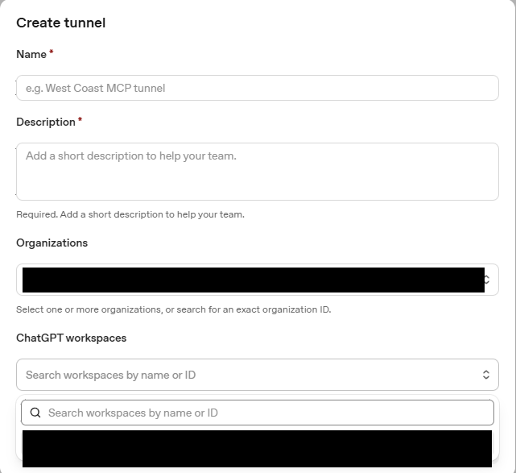
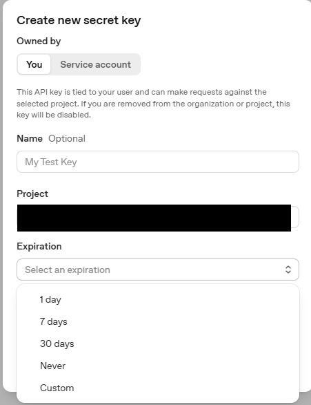
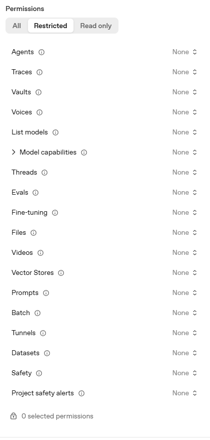
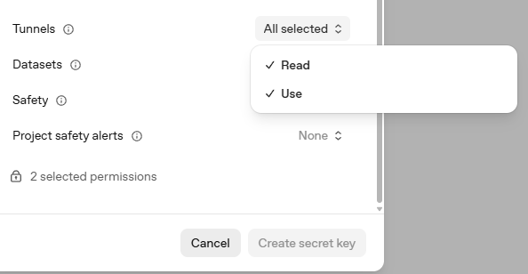
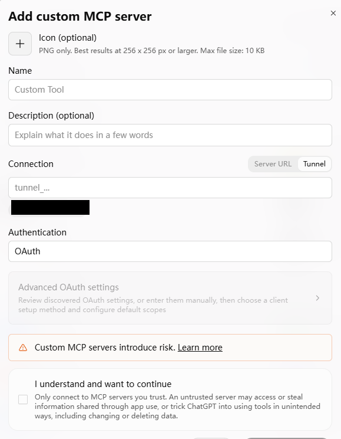
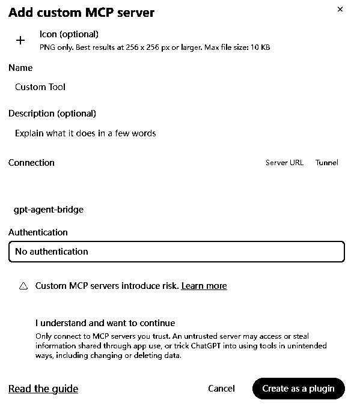
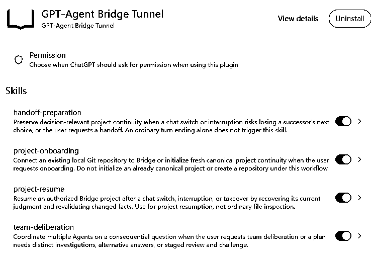
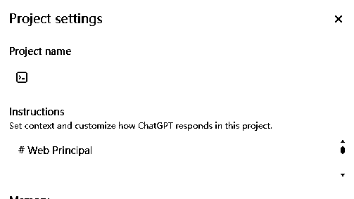

<a id="install-bridge-and-begin-in-an-ordinary-chatgpt-project-chat"></a>
# Set up Bridge and use it in ChatGPT Web

[English](GETTING-STARTED.md) | [简体中文](GETTING-STARTED.zh-CN.md)

Follow steps 1–10 in order. You will prepare Bridge on your computer, connect it
to an ordinary **ChatGPT Web Project Chat**, and check the connection before
authorizing any project work.

## Choose your computer

| Your computer | Where Bridge runs | Where you open ChatGPT | Preparation instructions |
| --- | --- | --- | --- |
| **Native Ubuntu Desktop** | On Ubuntu itself | Chrome on that same Ubuntu computer | [Ubuntu Terminal](#native-ubuntu-desktop); no WSL or PowerShell |
| **Windows + WSL2** | Inside your chosen WSL2 Linux installation | Windows Chrome | [Windows PowerShell](#windows-and-wsl2); select the correct Linux installation |

Start with step 1 below; the platform links identify the launcher used in step 3.
Both routes join the same ChatGPT Web instructions in step 5. This guide does not
cover a remote Ubuntu server with a browser on another computer.

**What setup changes:** after you approve its prompts, preparation creates its own
Python environment, downloads checked dependencies, prepares private extension
files, and **installs, enables and starts two Linux background services**: Bridge
and its Secure MCP Tunnel connection. It does not install Herdr or an Agent,
sign into a provider, move your project, or send tasks. Loading the Chrome
extension and turning on completion reminders in step 9 are optional; Bridge
tools and Skills do not require reminders.

**Testing status:** these instructions describe the source-supported routes.
The complete native Ubuntu beginner flow and fresh Windows/account setup,
Chrome loading and restart behavior have not been field accepted. Screenshots
show example controls, not success on your computer.

A few names used below:

| Name | What it means here |
| --- | --- |
| **Herdr / Agent** | Herdr manages local terminal sessions. An Agent is a coding or research assistant you have started in one of those sessions. |
| **Tunnel** | The private connection between ChatGPT and Bridge on your computer. |
| **Tool / App / Plugin** | A tool performs an operation, such as reading a file. An App is the Bridge connection; a plugin is the item you install and select in ChatGPT. |
| **Skill** | A reusable set of instructions installed in the plugin. It is not a running local Agent. |
| **Project / Core / Binding** | A ChatGPT Project groups chats and instructions. Core is the supplied base instruction text. Binding is the additional text identifying the local project you permit it to use. |

You control accounts, repositories and permissions. Use ordinary Web Chat
throughout; Work, local Codex and a separate model API Principal are not required.
Model availability, Agent-provider sign-in, fees and quotas remain yours.

<a id="1-obtain-the-complete-release-and-check-prerequisites"></a>
## 1. Download the complete bundle and check prerequisites

**In your browser:** open the
[Releases list](https://github.com/HowAreAllWell/gpt-agent-bridge/releases).
Choose a reviewed **PRE-RELEASE** and download its attached **complete installation
ZIP** as one bundle. Review that release's source commit, changes, limitations
and [LICENSE](../LICENSE). Extract the whole ZIP and keep the folder.

Do not use GitHub's automatic **Source code (zip/tar.gz)** or **Code → Download
ZIP**. Those are source archives, not complete installation bundles: they lack the
preparation manifest and Git metadata. The complete folder should contain
`Start-Bridge.ps1`, `prepare`, `release-manifest.json`, `src/`, `scripts/`,
`systemd/`, `browser-extension/`, `templates/` and all four `skills/*/SKILL.md`
files. The manifest checks bytes; it is not an independent publisher signature.

If no complete authorized installation ZIP is attached, stop and request one.
You do not need to assemble a developer build. Main-branch documentation may
describe changes not included in an older ZIP; it does not update that ZIP.
Do not add private files or screenshot archives to a release folder.

**Before continuing, check your computer and accounts:**

- **Ubuntu:** use your normal, non-root Ubuntu account with administrator permission
  available when requested. The system must already use **systemd**, the Linux
  background-service manager. The pinned Linux downloads cover `x86_64` and
  `aarch64`; this is not a guarantee for every Ubuntu version or computer.
- **Windows:** use an existing **WSL2** Linux installation with systemd and its
  normal Linux user. WSL2 runs Linux inside Windows. WSL1, native Windows service
  installation and native macOS installation are not supported here. For missing
  WSL, use [Microsoft's instructions](https://learn.microsoft.com/en-us/windows/wsl/install).
  The launcher does not convert WSL1 or enable systemd.
- **Herdr 0.9.0 must already be installed in that Linux environment.** Reuse a
  working installation. If missing, follow only the
  [compatibility check](QUICKSTART.md#herdr-compatibility-and-version-selection)
  and, if needed, the [pinned Herdr installation subsection](QUICKSTART.md#2-optional-separate-v090-installation).
  Those are user-run prerequisite steps, not another full Bridge installation.
  You do **not** need Herdr open or any Agent running just to set up Bridge.
- Python **3.10+**, Python's `venv` support and Git are needed locally.
  Preparation can ask permission to install missing packages through `apt-get`;
  other package-manager environments need their own supported setup.
- In ChatGPT, you need access to **Project Instructions**, custom MCP connections,
  and **Plugin Creator** in your intended workspace. A workspace is the personal
  or team area selected in ChatGPT. Access depends on plan and workspace policy;
  a subscription alone does not prove eligibility.
- This guide uses **Chrome 120+**. It is required for the optional reminder
  extension; the extension is separate from the MCP connection.

**You can continue when:** you have a complete trusted bundle, a chosen Linux user
and compatible Herdr, and access to the needed account controls. If any item is
missing, resolve that prerequisite first. Do not launch a demo or delegate a task.

<a id="2-prepare-your-tunnel-and-restricted-runtime-key-privately"></a>
## 2. Prepare the private connection and its key

**On the OpenAI Platform website:** open
[Tunnel settings](https://platform.openai.com/settings/organization/tunnels).
Select the Platform **organization** that will own the connection. This is the
administrative account area on Platform, not your ChatGPT Project.

1. Reuse a suitable Tunnel or create your own. For a new one, fill in **Name** and
   **Description**.
2. Choose the intended **Organizations** and **ChatGPT workspaces** in the offered
   controls. Associate the Tunnel with both the owning organization and the
   workspace where you will use ChatGPT. Matching names are not proof of association.



*Example controls only. The image does not show a completed Tunnel.*

Creating/editing needs **Tunnels Read + Manage**. Running the connection and
selecting it in ChatGPT need **Read + Use**. The account behind your key also
needs that Tunnel role; selecting key permissions cannot grant a missing role.
If controls or permissions are missing, ask the organization owner/administrator.
See [OpenAI's Tunnel permission guide](https://developers.openai.com/api/docs/guides/secure-mcp-tunnels).

**In that same organization's [Runtime API keys](https://platform.openai.com/settings/organization/api-keys):**

1. Create a dedicated **runtime** key, not an Admin key. If **Project** is offered,
   select the intended Platform API project; this is different from a ChatGPT Project.
2. If expiration is offered and your dedicated service-credential policy permits,
   choose **Never**. Otherwise follow that policy and arrange replacement before
   expiry. Bridge does not set the expiration for you.



*Never is shown as an option, not as a saved setting or an issued key.*

3. Under **Permissions**, choose **Restricted**. Leave unrelated scopes at **None**;
   do not select the top-level **All** option.



*This example has not yet granted Tunnel access.*

4. Open **Tunnels** and select **Read** and **Use** separately. Confirm both are
   selected and all unrelated scopes remain **None**, then create the key.



*All selected here means those two Tunnel permissions, not top-level All.*

Keep the **Tunnel ID and runtime key private** for the local prompts in step 4.
Never paste them into Chat, Project Instructions, commands, screenshots or reports.
This key runs the connection; it is not a model-selection setting. Reuse suitable
working credentials rather than creating another Tunnel or rotating a key for
this guide.

**You can continue when:** the correct organization/workspace association and role
are available and you have the narrowly scoped runtime key. If the role or
workspace association is unavailable, stop at that account issue; local reinstalling
will not fix it.

<a id="3-start-preparation-and-confirm-the-exact-wsl2-distro"></a>
## 3. Start local preparation — choose one route

Complete steps 1–2 first. **The commands below can install, enable and start
services after your consent.** Do not run both launchers for the same setup.

<a id="native-ubuntu-desktop"></a>
### On native Ubuntu Desktop

**In Ubuntu Files:** open the extracted complete release folder. Open an Ubuntu
Terminal in that folder; if Files offers **Open in Terminal**, use it. Make sure
the terminal's current folder is the one containing `prepare`, then run:

```bash
./prepare
```

Use your normal user, not a root terminal. If asked to install Python/venv and Git,
read the request and type `yes` only if you agree; enter your Linux password
locally if administrator permission is requested.

**Expected result:** preparation reaches
`Trust this release and continue local preparation? [yes/no]`.
Review the stated changes and type `yes` only if you approve them.

**If it stops:** keep the exact non-secret error. If the file is absent or not
executable, check the extracted bundle and permissions before continuing.
Do not run it as root, remove existing installation files or invent a different
command to force it through. This native Ubuntu route needs no WSL, PowerShell
or Windows task.

<a id="windows-and-wsl2"></a>
### On Windows with WSL2

**In Windows File Explorer:** open the extracted complete release folder.
Click File Explorer's address bar, type `powershell` and press Enter to open
**Windows PowerShell in that folder**, then run:

```powershell
.\Start-Bridge.ps1
```

1. Check the listed WSL2 Linux installations. With one installed, check
   `Use WSL2 distro '…'? [Y/n]` and press Enter to accept, or `n` to decline.
   With several, type the **exact name** from the list.
2. Check `Using WSL2 distro: …`. Its default Linux user owns the preparation.
   The launcher does not change the WSL default, version or existing sessions.
3. If Python/venv or Git is missing, approve `sudo apt-get` only for that selected
   installation. Enter the Linux password locally if requested.
4. For a fresh Windows setup, at
   `Private Windows extension folder (existing parent, local NTFS)`, press Enter
   for `%LOCALAPPDATA%\GPT-Agent-Bridge-extension` or choose a **new folder under
   an existing parent** on a local NTFS drive. Do not add surrounding quotes.
   Confirm the location with `yes`. This folder is for Windows Chrome;
   Bridge and Tunnel stay in Linux.

**Expected result:** the selected Linux user/environment are correct and the
trust prompt appears. Existing installations are not moved or rekeyed.

**If it stops:** unknown names, WSL1, an unavailable installation or an occupied/
unsafe extension folder are reasons to inspect, not to reset things. If there
is no installed Linux system, the launcher can offer Ubuntu installation after
an explicit `yes` and possible Windows elevation/reboot. Finish Linux user
creation and any requested reboot before running the same entry again.
If Windows blocks the script, use Properties / Unblock or your administrator's
trust procedure; do not disable execution policy globally.

<details>
<summary>Advanced: Linux-only preparation inside WSL</summary>

The existing `./prepare` entry can also be run inside WSL. It keeps the extension
in Linux and can print a verified Windows-accessible WSL path. It does not select
a Windows-local extension folder. This is an alternative to the Windows launcher,
not a second step. For the normal fresh Windows route above, use Start-Bridge.ps1.

</details>

<a id="4-follow-the-one-local-preparation-through-its-handoffs"></a>
## 4. Finish preparation and save the printed locations

**Stay in the same local terminal.** Preparation creates its own product folder
and Python environment, installs dependencies, finds your existing Herdr 0.9.0
or asks for its full Linux program path, and downloads checked Tunnel runtime
**0.0.16**. Your work repositories are not moved. The
[pinned upstream package](https://github.com/openai/tunnel-client/releases/tag/v0.0.16)
is separate from Bridge.

Read the request to let the prepared extension see registered project identifiers,
their exact local folders and completion metadata, including future registrations.
Approve only if you accept that scope. It grants no report-body access or Agent
task authority, and does not allow messages into any Chat. Loading the browser
extension and enabling reminders remain optional.

<a id="keep-the-early-private-extension-path"></a>
### Save the extension folder separately from the workflow files

Before service setup, find **Expected extension ID:** and the extension-folder
label for your route:

| Route | Keep this output for optional step 9 |
| --- | --- |
| Native Ubuntu | `Private extension Linux path:` |
| Fresh Windows launcher | `Private extension Windows path (copy into Chrome Load unpacked):` and the complete final Windows-local path on the next line |

On Windows, `Windows publication is pending` is not completion. Wait for the
confirmed final location. Do not manually copy a token or `connection.js`.
For an existing Linux/WSL-only preparation, use the printed, verified location
rather than a guessed path. If Windows output says
`Windows extension path: unavailable/unverified`, stop and resolve that path issue.

<a id="approve-services-then-enter-credentials-locally"></a>
### Allow service setup, enter credentials privately, then check the result

Preparation asks for administrator permission for the two owned Linux services.
It installs/enables/starts Bridge, installs Tunnel, then configures and
enables/starts Tunnel. For a new install, port **8765** must be available.
Other services are not killed. Unsupported systemd/account layouts, unsafe
paths, symlinks, spaces or `/mnt` service paths can stop installation; a printed
extension folder does not bypass those checks.

If credentials are not already saved, the hidden local prompts are:

```text
Own Tunnel ID (hidden):
Own runtime API key (hidden):
```

Enter the complete values locally without quotes or added labels. They are not
echoed. Use a private interactive terminal; do not redirect input or send secrets
to Chat. Existing validated credentials are reused, but local checks do not
establish remote roles or expiry. You do not need to copy a secret Bridge endpoint.

Look for **Local checks:** and `"bridge_mcp": "initialized_healthy"`.
This proves a local initialized Bridge response only. Herdr may be unavailable
when closed; that does not require starting an Agent. A running service does not
prove the Tunnel's remote access or a working ChatGPT connection. Preparation
does not run the separate Tunnel readiness status probe.

Continue until you see:

- **Four unchanged, distinctly named Skill attachments and LICENSE:** followed
  by a folder. Keep this location for step 6; it is not the Chrome-extension folder.
- The optional **native own-App ID** prompt. **Press Enter** and use the existing
  connection selection in step 6; do not guess an identifier from a browser URL.
- **Unchanged Web Principal Core:** followed by the public instruction-file path.
- `Software preparation is complete; no repository or running Herdr session/Agent is required. You may close this terminal.`

**You can continue when:** preparation ends normally, the local Bridge check
succeeds, and you have the workflow folder and Core location. Keep the extension
location if you want reminders. No Web plugin, Skills, repository binding or
reminder destination has been completed by this local result.

**If it stops:** preserve completed files and the error; use
[If a step stops](#if-a-step-stops). Do not run separate service installers on top
of this preparation or repeat an action whose outcome is unknown.

<details>
<summary>Where preparation keeps files (do not copy or edit private configuration)</summary>

| Location | Purpose |
| --- | --- |
| Selected WSL user's `~/.local/share/bridge-release/` | Windows wrapper's checked release staging, not the Chrome loading folder |
| `<Linux account home>/.local/share/gpt-agent-bridge/product/` and `product/.venv/` | Private product and Python environment; account home comes from the Linux user record |
| Selected Windows-local folder (default `%LOCALAPPDATA%\GPT-Agent-Bridge-extension`) | Fresh Windows Chrome loading folder; keep its path and identity intact |
| `<Linux account home>/.local/share/gpt-agent-bridge/extension/` | Protected source for Windows publication; Linux/WSL-only preparation loads its printed receipt folder |
| Prepared extension folders' `connection.js` and `<Linux account home>/.config/gpt-agent-bridge/browser-notifications.json` | Generated private notification pairing; never share or copy its contents manually |
| `<Linux account home>/.local/share/gpt-agent-bridge/` | Extension receipt, pending recovery records, preparation lock and `Creator-attachments/` |
| `/var/lib/gpt-agent-bridge-tunnel-autostart/credentials.json` | Owner-only persistent Tunnel credentials, reused on later runs |

The strict installers also create protected service files under `/usr/local/lib/`
and `/etc/systemd/system/`, and private Bridge settings under
`/var/lib/gpt-agent-bridge-autostart/`. Do not edit generated files concurrently.
The preparation lock coordinates cooperating tools, not arbitrary external editors.

</details>

<a id="5-connect-the-tunnel-to-your-private-chatgpt-plugin"></a>
## 5. Connect Bridge in ChatGPT Web and check it

**In your intended ChatGPT workspace:**

1. Open [Plugins](https://chatgpt.com/plugins). Use the plus control and
   **Add custom MCP server**. Give the connection a recognizable name, such as
   your own Bridge name.
2. Set **Connection: Tunnel** and select your own Tunnel. If an official ID field
   is offered, enter that same Tunnel ID only there. Never put the runtime key
   into the form or either value into a Chat message.



*The form still shows its default OAuth option; it is not ready yet.*

3. For this private Bridge connection, change MCP authentication to
   **No authentication**. Bridge has no OAuth server; Tunnel roles and the
   protected local endpoint still apply. This does not create a public
   unauthenticated endpoint.
4. Read the risk warning. Only if you accept its scope, choose
   **I understand and want to continue** and **Create as a plugin**.



*Example configuration, not proof that your plugin was created.*

5. Review the discovered tools and choose **Install** if offered. Create/open the
   ChatGPT **Project** you intend to use. Start an ordinary **Chat** in it,
   type `@` and select your Bridge plugin.
6. Send this check:

   > Call only read-only bridge_health and show its actual result. Do not register
   > a project, initialize notes, change files or send tasks to an Agent.

**Expected result:** a successful, non-error `bridge_health` tool result in that
ordinary Project Chat. A tool name, plugin card or sentence saying “connected” is not enough.
Herdr readiness is separate from Bridge connectivity.

**If the Tunnel is missing, access is denied or the call fails:** check the selected
workspace, organization association and permissions from step 2. Preserve the
local installation; do not reinstall it to fix account access. UI labels may
vary. If the required controls are absent, stop and use your workspace's access
process. [Official Tunnel connection guide](https://developers.openai.com/api/docs/guides/secure-mcp-tunnels).

<a id="6-install-and-discover-all-four-native-skills"></a>
## 6. Add and check the four reusable workflows

The previous step connected **tools**. Now install four **Skills**: reusable
instructions for connecting a project, returning to it, saving a handoff and
organizing independent Agent investigations. They must be installed workflows,
not just files attached to a conversation.

### Find the five upload files

**On your computer:** open the folder printed after
**Four unchanged, distinctly named Skill attachments and LICENSE:** in step 4.
It is named `Creator-attachments`. You do not need to create it or assemble files.

- **Native Ubuntu:** open **Files**, press **Ctrl+L**, paste the printed folder
  path and press Enter. If browsing instead and `.local` is hidden, use
  **Show Hidden Files** or **Ctrl+H**.
- **Windows+WSL2:** open **File Explorer → Linux**, or enter `\\wsl$` in the
  address bar. Choose the **same Linux installation and user as step 3**.
  Follow the printed Linux folder path inside it; this is not the Windows
  Chrome-extension folder.

Select these **five files**, not the whole folder or installation ZIP:

| File to upload | Installed workflow name / purpose |
| --- | --- |
| `project-onboarding.md` | `project-onboarding` — connect an existing local project |
| `project-resume.md` | `project-resume` — recover context when returning |
| `handoff-preparation.md` | `handoff-preparation` — preserve what matters before leaving |
| `team-deliberation.md` | `team-deliberation` — organize independent Agent work |
| `LICENSE` | Keep the supplied license with the workflows |

Do not upload connection/configuration files or private project notes. If this
folder or any file is missing, stop and check the preparation result.

<details>
<summary>Reference: the supplied workflow originals</summary>

The distinctly named upload files preserve these original instruction files:
[project-onboarding](../skills/project-onboarding/SKILL.md),
[project-resume](../skills/project-resume/SKILL.md),
[handoff-preparation](../skills/handoff-preparation/SKILL.md) and
[team-deliberation](../skills/team-deliberation/SKILL.md).
Upload the named copies from preparation, rather than downloading four files
all named `SKILL.md`.

</details>

### Open Plugin Creator and attach the files

**In ChatGPT Web:** open **Plugins**, select your existing Bridge plugin and use
**Edit Plugin** if it is offered and you have edit access. Otherwise, start an
ordinary Chat, type `@`, search for **Plugin Creator** and select it.
If absent from `@`, look for it in Plugins and install it only if your workspace
permits. If unavailable, blocked, or only usable in Work, stop here.
[OpenAI's creation guide](https://learn.chatgpt.com/docs/build-plugins) describes
the permission-dependent controls; it does not guarantee your account's access.

Click the message box's **attachment/add button** and choose the option for
uploading files from your computer. Select the five files above. Wait until
**all five attachments are visible without an upload error**, then send:

> Add these four files as four separate installed Skills in my private Bridge
> plugin. Keep their full instructions, names, descriptions and LICENSE unchanged.
> Reuse the Bridge connection that worked in step 5. Show the four complete Skill
> texts and selected connection before I finish. Do not create a new connection,
> ask for keys, share the plugin, run these workflows or send Agent tasks.
> If this cannot be done here, explain what is missing and stop.

If the existing plugin cannot be edited, ask Creator whether a private combined
plugin can reuse that same authorized connection. Do not assume that option
exists, convert an ID, recreate credentials or switch to Work/Codex to complete
this Web Chat setup.

### Review, finish and test a new Project Chat

1. Check **four separate Skills** named `project-onboarding`, `project-resume`,
   `handoff-preparation` and `team-deliberation` — the installed names omit `.md`.
   Compare their **complete texts** with the supplied files.
2. Check that the selected App/connection is the **same Bridge connection** from
   step 5. If a connection menu appears, select that existing entry by name.
3. Use the finish/save and installation controls actually offered. Installation
   may be an **Install** button or a **plus** control in plugin details. Do not
   grant blanket tool permission just to match an example.



*The blue switches show the example's displayed settings. They do not prove that
your four complete workflows were installed or are available in ordinary Chat.*

4. In the intended ChatGPT Project, start a **new ordinary Chat**, select the
   resulting Bridge plugin through `@`, and send:

   > Read-only setup check: list the Bridge tools available here. Find the installed
   > Skills project-onboarding, project-resume, handoff-preparation and
   > team-deliberation, and show each complete instruction text without running it.
   > Call only bridge_health and show its actual result. Do not register a project,
   > change files or send Agent tasks.

**You can continue when:** the actual Project Chat has Bridge tools (compare the
[18-tool reference](TECHNICAL-REFERENCE.md#tool-reference)), a real health result,
and all four complete installed Skill texts matching the supplied files.
Four names, uploaded attachments or a statement “installed” are not sufficient.
Discovery does not prove reliable automatic triggering in later work.

**If any control, upload or full-text check fails:** retain the working connection
and record **“Tools work; the four workflows are not verified.”** Keep the exact
non-secret error and ask the workspace administrator/owner about creation,
installation or App access. Do not rebuild Tunnel to force Skill discovery.

Work/Codex success does not establish this ordinary Web check. This is the
supported product target, not host-enforced isolation: official documentation
does not establish a `web_only` restriction preventing cross-surface visibility.
See [packaging diagnostics](TECHNICAL-REFERENCE.md#attachment-and-discovery-diagnostics).

<a id="7-put-the-public-core-in-project-instructions"></a>
## 7. Add the base instructions to your ChatGPT Project

**In your browser:** open the supplied
[Web Principal Core text](../templates/WEB-PRINCIPAL-CORE.md). This is the base
instruction text for how ChatGPT should reason and work with you.

**In that same ChatGPT Project:** open **Project settings → Instructions**.
Copy the **complete public Core text** into that field while retaining relevant
existing rules. Keep the supplied text intact. This is a saved Project setting,
not an installation command, Skill upload or one-off Chat message. It contains
no credentials and gives no permission to act on an arbitrary repository.



*Example control only; no explicit save button is shown.*

Finish using the controls actually present. **Reopen Instructions** and check that
the full text persisted without truncation and your prior rules remain.
Never add secrets or another project's Binding.

**Expected result:** complete Core and retained rules in the intended Project's
saved Instructions. **If the field is missing, text is rejected or shortened:**
stop and check account controls/limits; a partial paste is not completed setup.

<a id="8-connect-your-existing-git-repository-and-merge-its-binding"></a>
## 8. Authorize one existing local project

Choose the **existing Git repository folder** you want to connect and a short
project identifier (`project_ref`) to distinguish it. Use its **full Linux path**:
on Ubuntu, its Ubuntu path; on Windows, the path inside the selected WSL system.
On Ubuntu, you can copy the open project folder's full path from Files with
**Ctrl+L**. A Windows drive path or a `\\wsl$` address is not a Linux path;
if unsure, ask the repository owner to confirm its Linux root before continuing.
The name of a ChatGPT Project alone does not select a local folder.

**In the Project's ordinary Chat with Bridge selected:** provide those two values
in your own words, then ask:

> Use project-onboarding to connect only this existing repository. Inspect its
> registration; register only if needed. Return the Project Binding text for me
> to review and save in this Project's Instructions. Do not create a repository,
> initialize project notes, launch Agents, send tasks or edit project files.

The returned **Project Binding** (also called **Host Binding**) is the text telling
this ChatGPT Project which local repository it may address. Check the returned
folder and identifier against your authorized choice. Manually add that text
beside Core in **Project settings → Instructions**, retain unrelated rules, then
reopen the setting to check it saved. No local registration/sync command is needed.

**Expected result:** the returned folder/identifier match and the intended Project
has their saved Binding. **If registration is uncertain or points elsewhere:**
inspect the returned read-only observations and ask the owner to reconcile;
do not silently redirect it or blindly register again.

Connection-only ends here if that was all you authorized. Creating initial local
state/memory with `project_initialize` needs a separate explicit request.
Registration does not authorize Agent tasks or choose a reminder destination.
[Project notes and continuity](PROJECT-CONTINUITY.md) explain that separate layer.

<a id="9-load-the-private-extension-and-bind-this-exact-chat"></a>
## 9. Optional: turn on completion reminders

**Skip to step 10 if you do not want browser reminders.** Bridge tools and Skills
can work without this extension. For native Ubuntu, the browser and Bridge must
be on the **same physical computer** for this local reminder route.

**In Chrome on your chosen computer:**

1. Open `chrome://extensions`, turn on **Developer mode**, choose **Load unpacked**.
2. Select the **private prepared extension folder printed in step 4**:
   **Ubuntu Chrome → printed Linux folder**;
   **Windows Chrome → final printed Windows-local folder**.
   For the advanced Linux/WSL-only route, use only its printed verified path
   appropriate to the browser's host.
3. Compare Chrome's extension ID with **Expected extension ID:** from preparation.

Do not select the ZIP, public/source folder, release staging folder or
`product/browser-extension/extension` template. On Windows, do not substitute the
WSL publication source for the final Windows folder. Keep the prepared folder,
its `connection.js`, loading location and identity intact. Do not copy its secret
contents. If the ID differs or Chrome cannot load it, stop; do not move it,
uninstall/reinstall or clear storage to bypass the failure. Fresh Ubuntu/Windows
Chrome loading, WSL UNC loading and restart behavior are not field accepted.

**In the exact ordinary, non-private Project Chat that should receive reminders:**
keep only one ordinary tab open for that full Chat route. Open the extension popup:

1. Under **本地项目** (local project), choose the registered repository and check
   its folder/identity.
2. Tick **允许向当前 Chat 自动发送完成提醒** (allow reminders to this Chat).
3. Click **设为接收 Chat 并启用** (set this as recipient and enable).
4. Check **接收 Chat：当前 Chat** and **自动通知已启用**; read any displayed error.

Enable **before delegating**: it does not replay older completions. Choosing a
different Chat later requires selecting and enabling that exact Chat explicitly.

An empty, safe message box can send a fixed reminder once. If you have a draft or
attachments, the extension instead offers **追加到输入框末尾（另起一行） / 忽略**
(append on a new line / ignore). Append preserves the draft and does not click
Send; you send the combined message yourself. Ignore leaves the draft/files intact.
Do not use a reminder as proof of task success or report review.

**Expected result:** the intended project and exact Chat visibly show enabled.
That proves the saved recipient selection, not delivered messages.
The adapter is currently verified only against **English ChatGPT Web/Project Chat
page structure**; other languages or changed UI may wait/refuse. If it fails,
read the popup's current error and use the
[reminder contract and recovery guide](LIFECYCLE-RESTART-CONTRACT.md#chrome-notification-authority-and-recovery).
Do not clear storage or repeat an uncertain send.

<details>
<summary>Advanced: exact delivery, draft and non-replay boundaries</summary>

Bind **before delegation**: first enable does not replay older completions. Each
local project has one explicit recipient; adding a project or opening another Chat
does not select it. To change it, explicitly select the new current Chat and authorize
enable again. Only provably never-attempted queued/waiting reminders with a valid
saved route may follow for their **first send**. Old attempted, ambiguous or frozen
identities never move or replay, even after returning to the original Chat, worker
restart or producer epoch change. Their retained raw-ID suppression evidence does
not block a different new Work or create a standing warning; do not clear storage
to bypass it. The 128 limit is for live unattempted reminders, not settled history.

A truly empty, safe composer can send the fixed notice automatically once. A real
text, rich-content or uploaded-file draft instead gets a nonmutating inline
**追加到输入框末尾（另起一行） / 忽略** choice, including while you type or use IME.
Ignore leaves the current draft and attachments intact. Append, after active IME
composition ends, adds only a fixed notice paragraph to the current bound editor;
it does not click Send, replace your draft or transmit file contents to the worker.
Normal edits and attachment changes need no quiet wait. If you submit before an
asynchronous Append executes, it refuses that old choice; choose again for the
current message. An undecided reminder stays pending after refresh/close; the next
normal poll rechecks the exact Chat and may offer again or use the safe empty path.

A local Send click or successful explicit choice is handled once, not proof that
ChatGPT received a message or that a backend acknowledged it. Unknown effects are
not retried. No transcript/receipt scan, notification history UI or old-unknown
warning is used to confirm delivery. Current errors and pending diagnostics remain.

</details>

<a id="10-begin-daily-use-with-a-bounded-read-only-check"></a>
## 10. Begin with a small read-only check

**In the connected ordinary Project Chat:** name one non-secret file in the
authorized repository and ask:

> Check only this project's current context and the file I named, then summarize
> what you can verify from it. Do not edit files, run commands/tests, take Git
> actions, initialize notes or send input to an Agent.

Check the returned folder/identifier and cited content. **Expected result:**
the actual requested file was read from the correct project. This tests only
that read path; it creates no Agent task or completion reminder. If the project
or file differs, stop and resolve the selection before authorizing more.

### When you want Agents to do real work

Open **Herdr in the same chosen Linux environment**, enter the authorized Git
folder, then start/sign into your supported Agent. Reuse an already suitable
session. Bridge does not install or start Herdr, providers or Agents for you.
You can open Web Chat before or after starting them.

Ask ChatGPT to refresh project context and show the actually available Agents.
A failed/incomplete observation means unknown, not “there are no Agents.”
Then state the question, allowed changes and acceptance criteria, and explicitly
authorize input to an observed eligible Agent. ChatGPT must read complete reports,
using `work_report`, completing all pages pinned to the full report SHA (its
fingerprint), and inspect relevant
code/diffs/test evidence before accepting claims. A reminder is not that review.
The [invoice demo](QUICKSTART.md#optional-invoice-demo) is optional and grants no
permission to launch a demo Agent.

**No daily preparation is needed.** While the machine/network and installed
services remain available, the preparation terminal and Herdr need not stay open
just for Bridge connectivity. Ubuntu reboot/suspend, Windows logout and WSL
shutdown/suspension are separate availability boundaries; restart acceptance is
not claimed. The [optional Windows WSL login helper](AUTOSTART.md) is a separate
operator choice and is not needed on native Ubuntu.

**If no real task was authorized, stop after the read-only check.** Tool access,
installed instructions and reminder settings do not expand your authorization.

<a id="if-a-step-stops"></a>
## If a step stops

Keep completed files and the exact **non-secret** error. If you do not know
whether an action changed something, inspect before trying again. Do not reset,
replay or reinstall to guess.

| What you see | What to do next |
| --- | --- |
| Missing/rejected/shortened Project Instructions | Check actual account controls and text limits. Retain prior rules; do not call a partial Core paste complete. |
| Preparation stops while copying/installing | Preserve files. Use the same release, path and Linux user only after inspecting the failure; matching files can be reused, an owned partial Python environment can finish, and unknown changes stop. Another release is not an automatic upgrade. Do not delete setup records, generated keys or folders. |
| Windows folder publication stopped | Keep the recorded target and staging files. Do not choose another folder, move the original extension or manually copy secrets. Inspect the diagnostic before another attempt; an earlier attempt may already have reached service setup. |
| Linux extension path exists but Windows path is unverified | Check the selected WSL installation/path conversion. Do not guess a Windows path or continue as though Chrome loaded it. |
| Service installation/start failed or outcome unknown | Preserve the installation. Follow [Bridge status/owner guidance](AUTOSTART.md#bridge-component-contract) or [Tunnel status/owner guidance](AUTOSTART.md#tunnel-component-contract) for that layer. Do not kill other services or repeat an uncertain start. |
| Tunnel missing in ChatGPT, or 403 | Recheck owning organization, target workspace association, the operator/key account's Tunnel role and Restricted Read + Use scopes. Fix access, not another local installation. |
| Tools work but four Skills are unavailable | Keep the connection; resolve Creator/installation permissions and verify complete installed texts in ordinary Web Chat. |
| Project registration uncertain/conflicting | Inspect read-only registration observations; ask the owner to reconcile, without redirecting or blindly registering again. |
| Reminder waits or outcome unknown | Check the exact recipient Chat for Append/Ignore and the popup error. Busy/unsafe message boxes, uploads or active input composition can defer automatic Send. Do not clear storage, replay old unknown sends or substitute a synthetic diagnostic for a real first-use check. |
| Saved Tunnel key is wrong/expired | Use only the explicit recovery action below; never send the replacement to Chat. |

<details>
<summary>Advanced recovery: status, credential replacement and existing extensions</summary>

For recovery only, Windows `.\Start-Bridge.ps1 status` (Linux `./prepare status`)
reports preparation-file existence, **not service health**. Separate Tunnel status
may say `tunnel_startup: ready` while remote control-plane verification and Web
readiness remain unestablished. The actual Project Chat health call is the remote
checkpoint; do not run repeated status commands as a daily ritual.

To replace a saved key, run `.\Start-Bridge.ps1 credentials` (Linux
`./prepare credentials`) from the **same release**. Confirm replacement and enter
values at the hidden local prompts. Services initially stay unchanged; a separate
prompt asks permission to stop/start **only the owned Tunnel service** with sudo.
Declining defers activation. Observe an uncertain outcome before another change;
Bridge itself need not restart. This is recovery, not a second first-use route.

Adopting an older extension installation needs separate authorization. Preserve
its original path, ID/key, token and history. See the
[extension contract](LIFECYCLE-RESTART-CONTRACT.md#chrome-notification-authority-and-recovery)
and service references; they are not additional required installation steps.

</details>
